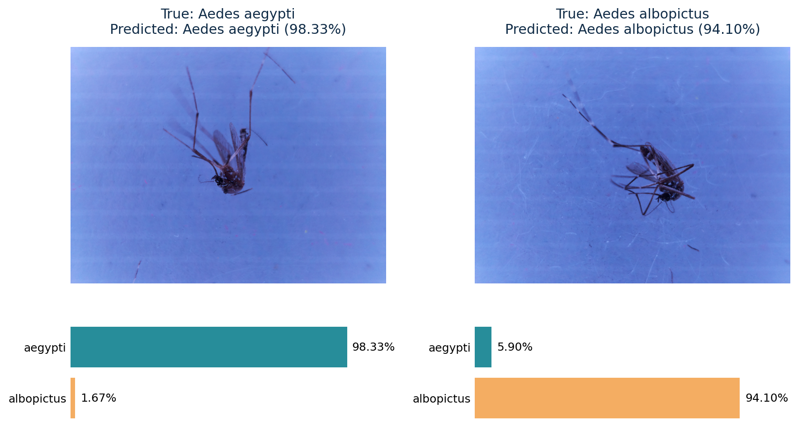

# Aedes Mosquito Species Classification

A Python and TensorFlow project that classifies mosquito images as **Aedes aegypti**
or **Aedes albopictus** using MobileNetV2 transfer learning. The trained classifier
achieved **91.94% accuracy on 720 held-out test images**.

## Demo and results



| Result | Value |
| --- | ---: |
| Test accuracy | **91.94%** |
| Correct test predictions | 662 / 720 |
| Macro F1 score | 91.94% |
| Images used | 4,800 |
| Supported species | 2 |

Demo prediction scores are **98.33% for aegypti** and **94.10% for albopictus**.
These are individual softmax scores, not overall accuracy or calibrated probabilities.

Read the [full project report](reports/README.md) for the methodology, per-species
metrics, confusion matrix, training curves, and limitations.

## Setup and training

The Kaggle dataset `pradeepisawasan/aedes-mosquitos` contains species-labeled
images for `aegypti` and `albopictus`, without bounding boxes. Use the classifier
below for this dataset. The object detection instructions later in this README
are a separate workflow requiring bounding-box annotations and a trained detector.

Use Python 3.9 and install the classification dependencies:

```bash
python3.9 -m venv env
source env/bin/activate
pip install -r requirements-classifier.txt
python download_dataset.py
```

The full dataset download is approximately 18.9 GB. The download script prints
its local location. Pass that location to the training script:

```bash
python train_classifier.py \
  --data datasets/datasets/pradeepisawasan/aedes-mosquitos/versions/2 \
  --epochs 5
```

Training uses a frozen ImageNet MobileNetV2 backbone and learns a two-species
classification head. The first run downloads the backbone weights. CPU training
is supported. Resized, padded 224×224 images are cached under `classifier/resized`.
Three images named `Copy` are excluded. Matching numeric filename IDs, including
all views and rotations, stay together in stratified 70/15/15 train/validation/test
splits. The dataset's supplied folder split is replaced because it shares these
IDs across training and testing. Filename grouping is a precaution; it does not
establish independence across collection sites or sessions.

The best validation-loss model is saved to `classifier/best.keras`. Class names,
split membership, test accuracy, and the confusion matrix are saved beside it.
Run species prediction with:

```bash
python classify_image.py -i /path/to/mosquito.jpg
```

Input images should contain a mosquito resembling the training images. This is a
two-class species classifier: it does not locate insects, reject non-mosquito
images, or determine whether a mosquito carries dengue. Output scores are model
scores, not calibrated probabilities. The COCO `labelmap.pbtxt` and EfficientDet
weights are not used by this classifier.

## Original object detection workflow

### **Step-1: #For Install Python 3.9**

* > Create Virtual Enviroment* python3 -m venv env
  >
* > conda create -n tf2 python=3.9
  >
* > conda activate tf2
  >
* > conda install protobuf* OR
  >
* > pip install protobuf
  >

  ---

##### **Step-2: #Model Clone in a Folder**

* > git clone https://github.com/tensorflow/models.git
  >

  ---

### **Step-3 #Add Protobuf File**

* > Add use_protobuf.py File  in models/research Folder & Add Below Code In this File
  >

> import os
> import sys
> args = sys.argv
> directory = args[1]
> protoc_path = args[2]
> for file in os.listdir(directory):
> if file.endswith(".proto"):
> os.system(protoc_path+" "+directory+"/"+file+" --python_out=.")
>
> ---

### **Step-4: Protoc Command Setup**

* Run Below Command In models/research Folder

> python use_protobuf.py object_detection/protos protoc
>
> ---

### Step-5: Setup File Ready

* > Copy the Setup File From object_detection/packages/tf2 to research Folder
  >

  ---

# Step-6: Install Setup File

> python -m pip install .

> conda install numpy

Step-6: Checking Everything is ok or not,  in the   #  cd /models/research/

> python object_detection/builders/model_builder_tf2_test.py

#### ** Noted that everything from the Research Folder

# **Step-7: Install wget**

* Run Below Command

  pip install wget

# Step -8: Model Download in object_detection/ Folder

* > Add python model_downloader.py In Not Add Previous and Write
  >

  ** import wget

  model_link = "http://download.tensorflow.org/models/object_detection/tf2/20200711/efficientdet_d0_coco17_tpu-32.tar.gz"
  wget.download(model_link)
  import tarfile
  tar = tarfile.open('efficientdet_d0_coco17_tpu-32.tar.gz')
  tar.extractall('.')
  tar.close()

  **
* Run the model_downloader.py File

  # Step -9 : Object Detaction with Below Command

> **Step 9.1: Install Requitrment:**
>
> python detect_from_image.py -m ssd_mobilenet_v2_320x320_coco17_tpu-8/saved_model -l data/mscoco_label_map.pbtxt -i test_images/
>
> **Step 9.2: Install Requitrment:**
> pip install opencv-contrib-python
>
> **Step 9.3: Object Detaiction By Webcam:**
> python detect_from_webcam.py -m ssd_mobilenet_v2_320x320_coco17_tpu-8/saved_model/ -l data/mscoco_label_map.pbtxt
>
> **Step 9.4: Object Detaiction By Videro:**
> python detect_from_video.py -m ssd_mobilenet_v2_320x320_coco17_tpu-8/saved_model/ -l data/mscoco_label_map.pbtxt -v video/test.mp4


 python detect_from_image.py -m efficientdet_d0_coco17_tpu-32/saved_model -l labelmap.pbtxt -i test_images/dengue/ ## for my model
    python detect_from_image.py -m training/ -l labelmap.pbtxt -i test_images/dengue/

..............**** ..............**** .............. *FIRST STEP DONE*  ..............**** ..............**** ..............

---

---

..............**** ..............**** .............. *SECEOND  STEP START*  ..............**** ..............**** ..............

# Step -10 : Start My Model

   1. Collect All Image In object_detection/images/ Folder 
   2. "xml_to_csv.py" file add in object_detection Folder and also run this PY File

# Step-11 (Generate TF Recode):
  1. generate_tfrecord.py File Add In object_detection Folder

  2. And those Command

    1.python generate_tfrecord.py --csv_input=images/test_labels.csv --image_dir=images/test --output_path=test.record

    2. python generate_tfrecord.py --csv_input=images/train_labels.csv --image_dir=images/train --output_path=train.record

# Step-12: Model Download in object_detection Folder

    1. Add python model_downloader.py In Not Add Previous and Write 
    ** If Add Before, Then Ignore this Step

        """
            import wget
            model_link = "http://download.tensorflow.org/models/object_detection/tf2/20200711/efficientdet_d0_coco17_tpu-32.tar.gz"
            wget.download(model_link)
            import tarfile
            tar = tarfile.open('efficientdet_d0_coco17_tpu-32.tar.gz')
            tar.extractall('.')
            tar.close()

        """

        This Code

    2.  Run the model_downloader.py File

# Step-13 (Config File Write):
    1. object_detection/configs/tf2 Folder find "ssd_efficientdet_d0_512x512_coco17_tpu-8.config" file and copy and Paste in object_detection Folder

    2. Add labelmap.pbtxt  File in object_detection Folder

    3. Re-Write ssd_efficientdet_d0_512x512_coco17_tpu-8.config File

# Step-14 Start Training:

    1.  Add training Folder in object_detection Folder
        1. Copy
            1. ssd_efficientdet_d0_512x512_coco17_tpu-8.config

            2. Add labelmap.pbtxt File in object_detection Folder

     *** Note That:  Remember That tensorflow Version Must Be 2.13.0
    pip install tensorflow==2.13.0 ***

    1. Run this Command
        python model_main_tf2.py --pipeline_config_path=ssd_efficientdet_d0_512x512_coco17_tpu-8.config --model_dir=training --alsologtostderr

        OR
        python model_main_tf2.py --pipeline_config_path=training/ssd_efficientdet_d0_512x512_coco17_tpu-8.config --model_dir=training --alsologtostderr

# Export graph
    python exporter_main_v2.py --trained_checkpoint_dir=training  --pipeline_config_path=ssd_efficientdet_d0_512x512_coco17_tpu-8.config --output_directory inference_grap

# Step-15: Start Detaction (Final Step):

  1.  Run Below Commnad For Image Detaction
  
      python detect_from_image.py -m efficientdet_d0_coco17_tpu-32/saved_model -l labelmap.pbtxt -i test_images/lang/

  2.  Run Below Commnad For Image Detaction
  
      python detect_from_webcam.py -m efficientdet_d0_coco17_tpu-32/saved_model/ -l labelmap.pbtxt

  3.  Run Below Commnad For Image Detaction
  
      python detect_from_video.py -m efficientdet_d0_coco17_tpu-32/saved_model/ -l labelmap.pbtxt -v video/dengue.mp4
      
