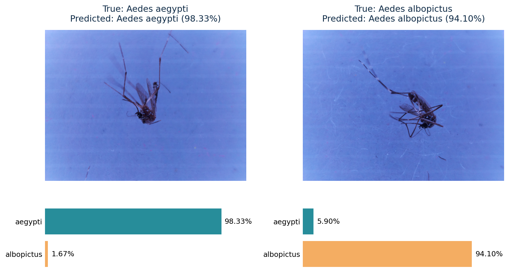
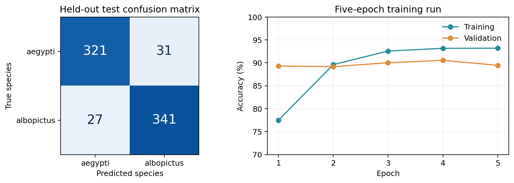

# Aedes Mosquito Species Classification Report

## Project overview

This project uses transfer learning to distinguish **Aedes aegypti** from
**Aedes albopictus** in mosquito images. A frozen MobileNetV2 backbone supplies
image features, and a trained classification head predicts one of the two species.
The saved model achieved **91.94% test accuracy**, correctly classifying
**662 of 720 held-out images**.

The implementation uses Python 3.9, TensorFlow 2.13, Keras, NumPy, Pillow,
and KaggleHub. Training and inference support CPU execution.

## Dataset and preparation

Dataset: [Aedes Mosquitos on Kaggle](https://www.kaggle.com/datasets/pradeepisawasan/aedes-mosquitos).

| Species | Original images |
| --- | ---: |
| Aedes aegypti | 2,403 |
| Aedes albopictus | 2,400 |
| Total | 4,803 |

Three images explicitly named `Copy` were excluded, leaving **4,800 images**.
Images were converted to RGB, resized with padding to **224 × 224 pixels**, and
cached for reuse. Pixel values were rescaled to **[-1, 1]** within the model.

| Split | Aegypti | Albopictus | Total |
| --- | ---: | ---: | ---: |
| Training | 1,696 | 1,664 | 3,360 |
| Validation | 352 | 368 | 720 |
| Test | 352 | 368 | 720 |

The split is approximately 70% training, 15% validation, and 15% testing, using
seed **42**. Matching numeric filename IDs stay together, including all associated
views and rotations. The dataset's supplied folder split was replaced because
matching IDs occur in both training and testing folders. This grouping reduces
overlap between splits; it does not establish independence across collection
sites or sessions. The 720 test images are not 720 independent specimens.

## Model architecture and training

```text
RGB image (224 × 224 × 3)
    → Pixel rescaling to [-1, 1]
    → MobileNetV2 pretrained on ImageNet (frozen)
    → Global average pooling
    → Dropout (25%)
    → Dense layer (2 units, softmax)
    → Aegypti / Albopictus
```

| Training setting | Value |
| --- | --- |
| Epochs | 5 |
| Batch size | 32 |
| Optimizer | Adam |
| Learning rate | 0.001 |
| Loss | Sparse categorical cross-entropy |
| Model selection | Lowest validation loss |

Only the classification head was trained; the backbone weights remained frozen.
The best checkpoint is saved as `classifier/best.keras` with class names in
`classifier/classes.json`.

## Demo predictions



The examples are the first non-rotated held-out image from each class, selected
without filtering by prediction score.

| Demo image | True species | Predicted species | Predicted species score |
| --- | --- | --- | ---: |
| `aegypti64a.jpg` | Aedes aegypti | Aedes aegypti | **98.33%** |
| `albopictus75b.jpg` | Aedes albopictus | Aedes albopictus | **94.10%** |

Percentages in this table are individual **softmax model scores**, not calibrated
probabilities or measures of overall test accuracy. Full demo scores and source
image paths are recorded in [demo_predictions.json](demo_predictions.json).

## Evaluation results

The selected model was evaluated on the separate 720-image test set.

| Metric | Result |
| --- | ---: |
| Test accuracy | **91.94%** |
| Correct predictions | **662 / 720** |
| Incorrect predictions | 58 / 720 |
| Macro precision | 91.95% |
| Macro recall | 91.93% |
| Macro F1 score | 91.94% |
| Test loss | 0.2460 |
| Final training accuracy | 93.18% |
| Selected-checkpoint validation accuracy | 89.44% |

Checkpoint selection used validation **loss**, rather than validation accuracy.
Precision, recall, and F1 below are calculated from the saved test confusion matrix.
Macro averages give both species equal weight.

| Species | Precision | Recall | F1 score | Test images |
| --- | ---: | ---: | ---: | ---: |
| Aedes aegypti | 92.24% | 91.19% | 91.71% | 352 |
| Aedes albopictus | 91.67% | 92.66% | 92.16% | 368 |

### Confusion matrix

Rows represent true species; columns represent predicted species.

| True species | Predicted aegypti | Predicted albopictus |
| --- | ---: | ---: |
| Aedes aegypti | **321** | 31 |
| Aedes albopictus | 27 | **341** |



## Run the project

Run the following commands from the repository root. See the
[project README](../README.md) for environment setup.

### Download the dataset

```bash
source env/bin/activate
python download_dataset.py
```

The complete download is approximately **18.9 GB**. The script prints the local
dataset path. Use that path for training if it differs from the example below.

### Train the classifier

```bash
python train_classifier.py \
  --data datasets/datasets/pradeepisawasan/aedes-mosquitos/versions/2 \
  --epochs 5
```

### Predict a species

```bash
python classify_image.py -i /path/to/mosquito.jpg
```

Example output from the held-out aegypti demo image:

```text
Predicted species: aegypti
aegypti: 98.33%
albopictus: 1.67%
```

## Scope and limitations

The reported accuracy describes this dataset and split. Performance on field
photographs, different equipment, backgrounds, or collection sites requires
independent evaluation. The classifier assumes that an input contains one of
the two supported species; it does not reject unrelated images, identify other
species, draw bounding boxes, or determine whether a mosquito carries dengue.
The earlier EfficientDet COCO scripts are a separate detection workflow and do
not use this species classifier.

## CV project description

**Aedes Mosquito Species Classification — Python, TensorFlow, Computer Vision**

Built an Aedes mosquito species classifier using TensorFlow/Keras and MobileNetV2
transfer learning; achieved **91.94% accuracy on 720 held-out images** from
**4,800 curated images**, with filename-grouped splits that kept related views
and rotations together.

## Files and evidence

| File | Purpose |
| --- | --- |
| [train_classifier.py](../train_classifier.py) | Preparation, grouped splits, training, and evaluation |
| [classify_image.py](../classify_image.py) | Species prediction for one image |
| [requirements-classifier.txt](../requirements-classifier.txt) | Classification dependencies |
| `classifier/best.keras` | Locally saved trained model |
| `classifier/metrics.json` | Saved evaluation results and training history |
| `classifier/splits.json` | Local split membership and filename groups |
| [demo_predictions.json](demo_predictions.json) | Recorded demo predictions |
| [demo_predictions.png](demo_predictions.png) | Illustrated demo |
| [evaluation.png](evaluation.png) | Confusion matrix and learning curves |
| [Word report](Aedes_Species_Classification_Report.pdf.docx) | Existing editable report |

Model weights, cached datasets, and training artifacts under `classifier/` are
excluded from Git by the project's `.gitignore`.
